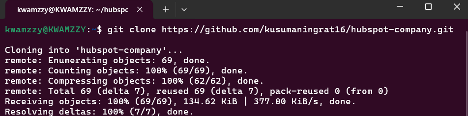
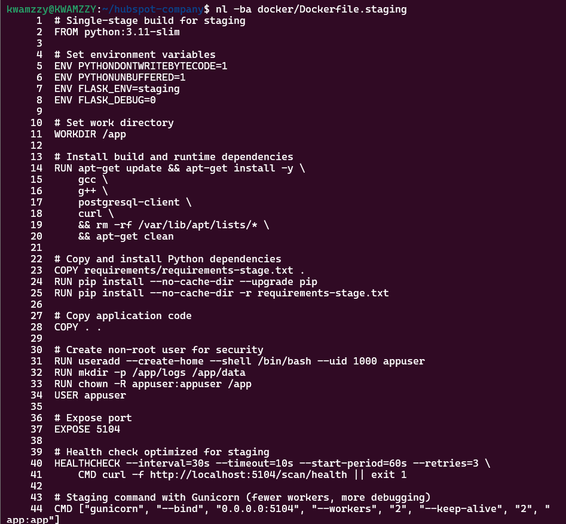
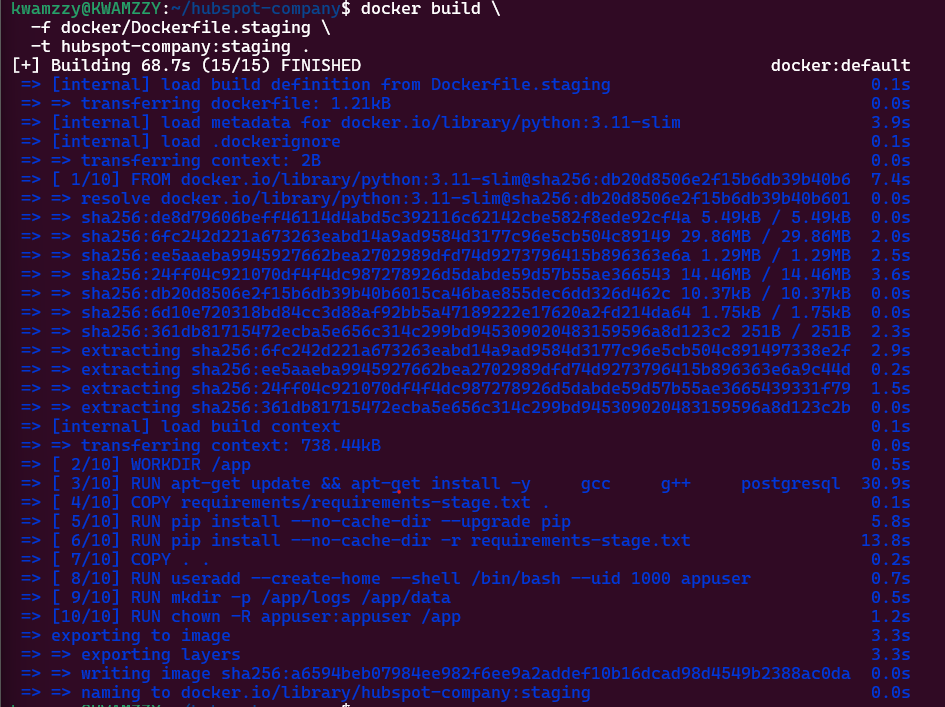
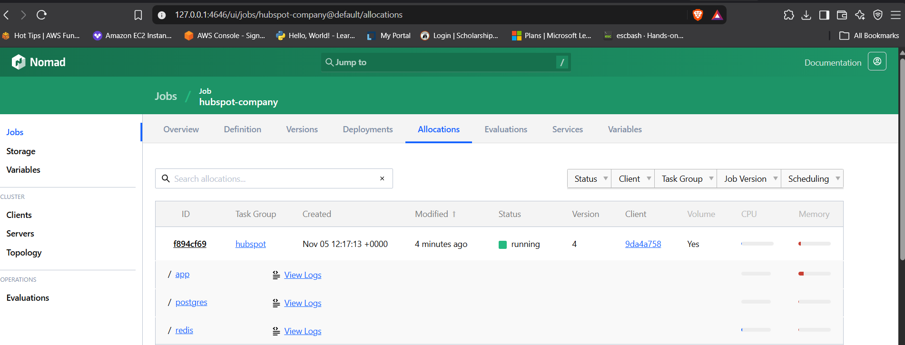
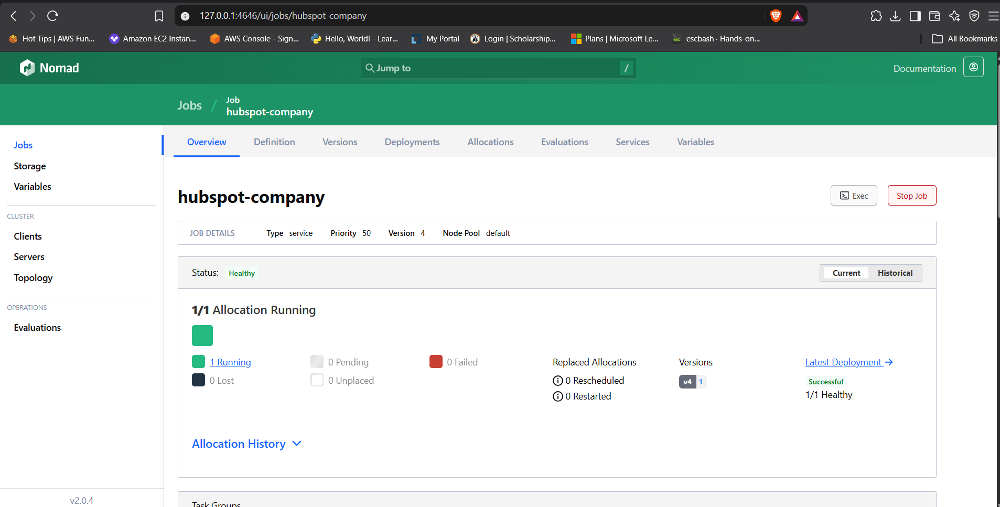
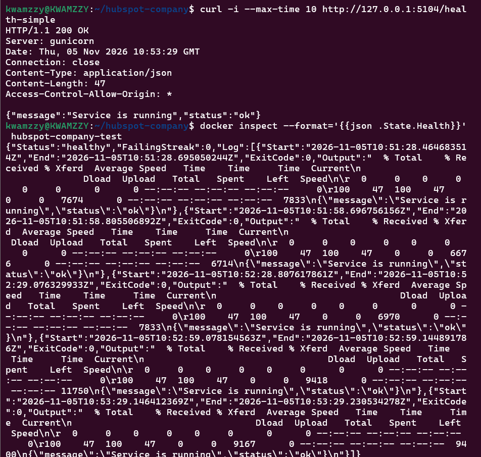
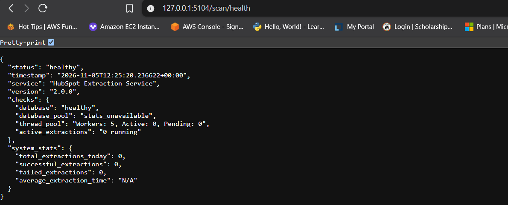
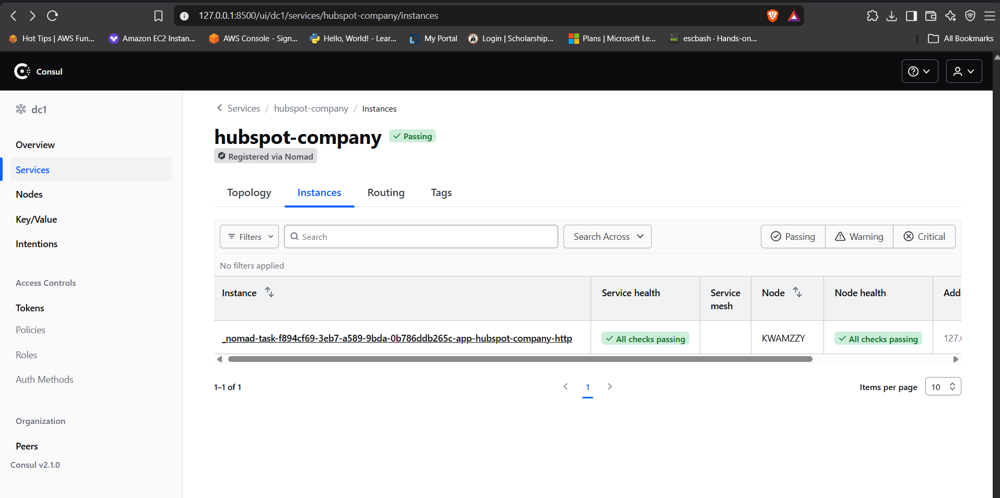
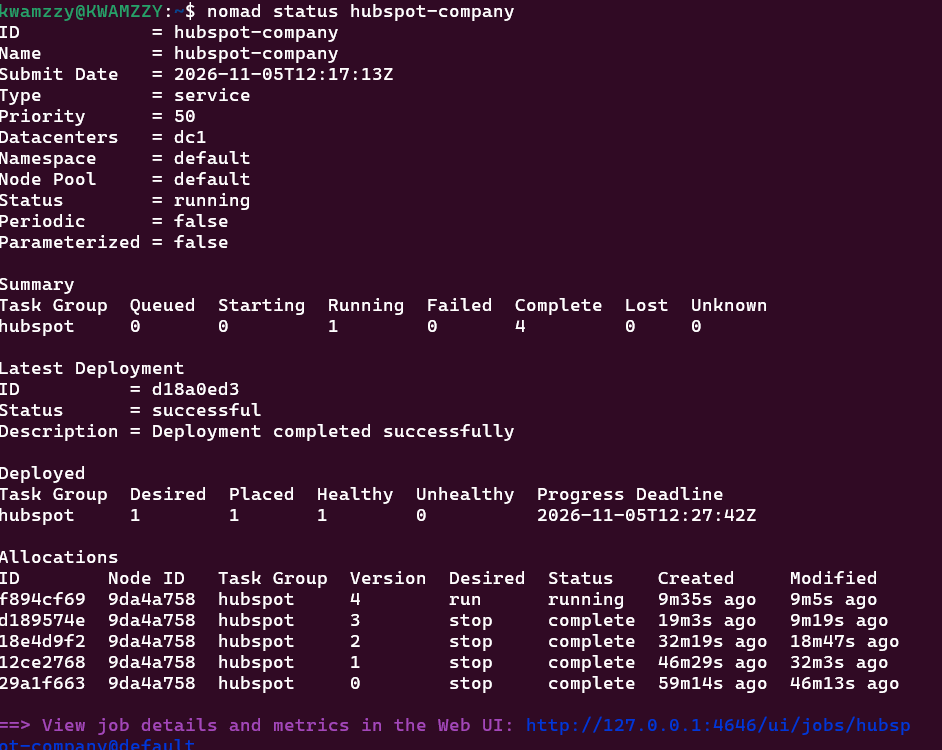

# HubSpot Company Extraction Service — Nomad Deployment

A containerized deployment of the **HubSpot Company Extraction Service** using Docker, HashiCorp Nomad, Consul, PostgreSQL and Redis.

This project demonstrates how an existing Flask-based application can be deployed and managed through HashiCorp Nomad, with supporting services, persistent storage, health monitoring, resource allocation and service registration.

The deployment is configured as a local staging environment using Docker and a Nomad development agent.

---

## Table of Contents

1. [Project Overview](#1-project-overview)
2. [Project Objectives](#2-project-objectives)
3. [Technology Stack](#3-technology-stack)
4. [Architecture](#4-architecture)
5. [Repository Structure](#5-repository-structure)
6. [Infrastructure Configuration](#6-infrastructure-configuration)
7. [Docker Configuration](#7-docker-configuration)
8. [Nomad Job Specification](#8-nomad-job-specification)
9. [Service Discovery with Consul](#9-service-discovery-with-consul)
10. [Health Checks and Monitoring](#10-health-checks-and-monitoring)
11. [Persistent Storage](#11-persistent-storage)
12. [Deployment Instructions](#12-deployment-instructions)
13. [Deployment Verification](#13-deployment-verification)
14. [Application Endpoints](#14-application-endpoints)
15. [Screenshots](#15-screenshots)
16. [Challenges and Solutions](#16-challenges-and-solutions)
17. [Security Considerations](#17-security-considerations)
18. [Current Implementation Status](#18-current-implementation-status)
19. [Future Improvements](#19-future-improvements)
20. [Conclusion](#20-conclusion)

---

## 1. Project Overview

The HubSpot Company Extraction Service is a Flask-based application that provides company extraction functionality.

The objective of this project is to containerize the application and deploy it using HashiCorp Nomad rather than relying solely on Docker Compose.

The deployment includes:

- The Flask application running inside a Docker container.
- PostgreSQL for persistent database storage.
- Redis as a supporting caching service.
- HashiCorp Nomad for workload orchestration.
- Consul for service registration and health monitoring.
- Docker for containerization and runtime execution.

Nomad manages the application and its supporting services as tasks within a job specification.

Consul provides service registration and health-check integration, allowing the deployed application to be registered within the service catalog.

The project uses a local staging environment to demonstrate the deployment process and validate the application.

## 2. Project Objectives

The main objectives are to:

1. Containerize the HubSpot Company Extraction Service using Docker.
2. Create a Nomad job specification to deploy and manage the application.
3. Deploy the application and its supporting services through Nomad.
4. Configure CPU and memory resource constraints for individual tasks.
5. Implement application health checks.
6. Register the application as a service in Consul.
7. Configure static port allocation for the application and supporting services.
8. Configure persistent storage for PostgreSQL and Redis.
9. Verify that the Nomad deployment reaches a healthy state.
10. Establish a foundation for automated deployment through GitHub Actions.

## 3. Technology Stack

| Technology | Purpose |
|---|---|
| Docker | Containerization and execution of application services |
| Docker Compose | Original application development environment |
| HashiCorp Nomad | Container workload orchestration |
| HashiCorp Consul | Service registration and health monitoring |
| PostgreSQL 15 | Persistent relational database |
| Redis | Caching service |
| Python 3.11 | Application runtime |
| Flask | Application framework |
| Gunicorn | Python application server |
| Ubuntu 24.04 | Deployment environment |
| WSL2 | Local Linux environment on Windows |
| Git and GitHub | Source control and project hosting |

## 4. Architecture

The deployment consists of one Nomad job containing three primary tasks:

- Application task
- PostgreSQL task
- Redis task

Nomad schedules and manages these tasks.

Docker provides the container runtime, while Consul receives the application service registration and performs HTTP health checks.

### Architecture Overview

```text
                    GitHub Repository
                           |
                           |
                    Docker Image
                           |
                           |
                    HashiCorp Nomad
                           |
                    hubspot-company
                           |
             +-------------+-------------+
             |             |             |
             |             |             |
          Flask App    PostgreSQL      Redis
          Gunicorn      Database       Cache
          Port 5104     Port 5433      Port 6379
             |
             |
        Health Endpoint
        /health-simple
             |
             |
           Consul
      Service Registration
      Health Monitoring
```

### Component Responsibilities

**Flask Application**

Runs the HubSpot Company Extraction Service and handles incoming HTTP requests.

**PostgreSQL**

Provides persistent storage for application data.

**Redis**

Provides a supporting caching service.

**Nomad**

Schedules, starts, monitors and manages the application and supporting tasks.

**Consul**

Registers the application service and performs health checks against its HTTP endpoint.

**Docker**

Provides the container images and runtime environment used by Nomad.

## 5. Repository Structure

The repository contains the application source code, deployment configuration, Docker configuration and deployment screenshots.

```text
hubspot-company/
│
├── app.py
├── config.py
├── requirements.txt
│
├── docker/
│   ├── Dockerfile.staging
│   └── docker-compose.yml
│
├── nomad-hubspot.hcl
│
├── screenshots/
│   ├── 01-nomad-job-healthy.png
│   ├── 02-docker-build-success.png
│   ├── 02-nomad-allocation-tasks.png
│   ├── 02-staging-dockerfile.png
│   ├── 03-consul-service-healthy.png
│   ├── 03-container-health-check.png
│   ├── 06-nomad-deployment-verification.png
│   ├── Repository_cloned_in_Ubuntu.png
│   └── database_healthy.png
│
└── README.md
```

Other application files and directories are retained from the original project.

## 6. Infrastructure Configuration

The project was developed and tested in a local Linux environment using Ubuntu on WSL2.

### Environment

| Component | Configuration |
|---|---|
| Host OS | Windows 11 Pro |
| Linux environment | Ubuntu 24.04.3 |
| Linux subsystem | WSL2 |
| Container runtime | Docker Desktop |
| Orchestrator | HashiCorp Nomad |
| Service discovery | HashiCorp Consul |
| Deployment environment | Local staging |

### Nomad

Nomad runs as a development agent and manages the deployment.

Nomad UI:

```text
http://127.0.0.1:4646/ui
```

### Consul

Consul runs as a development agent and provides the service catalog and health-check functionality.

Consul UI:

```text
http://127.0.0.1:8500
```

These addresses are for the local development environment and are not public production endpoints.

## 7. Docker Configuration

A dedicated staging Dockerfile was created at:

```text
docker/Dockerfile.staging
```

The staging image is based on Python 3.11 Slim.

### Dockerfile Responsibilities

The Dockerfile:

- Uses Python 3.11 Slim as its base image.
- Installs the required system dependencies.
- Installs PostgreSQL client utilities.
- Installs curl for HTTP health checks.
- Installs Python application dependencies.
- Creates a non-root application user.
- Configures the application working directory.
- Exposes application port 5104.
- Configures a Docker health check.

### Image Build

Build the staging image using:

```bash
docker build -f docker/Dockerfile.staging -t hubspot-company:staging .
```

Verify that the image exists:

```bash
docker images | grep hubspot-company
```

The image is built locally and used by the Nomad Docker driver.

### Container Health Check

The Docker health check uses the lightweight application endpoint:

```text
/health-simple
```

The configured health check is:

```dockerfile
HEALTHCHECK --interval=30s --timeout=10s --start-period=60s --retries=3 \
    CMD curl -f http://localhost:5104/health-simple || exit 1
```

This endpoint verifies that the application HTTP service is responding.

A separate endpoint, `/scan/health`, provides a deeper application and database health check.

## 8. Nomad Job Specification

The deployment configuration is defined in:

```text
nomad-hubspot.hcl
```

The job is named:

```text
hubspot-company
```

The job contains a group named:

```text
hubspot
```

The group runs the application, PostgreSQL and Redis tasks.

### Task Configuration

| Task | Purpose | CPU | Memory |
|---|---|---:|---:|
| app | Flask application | 1000 MHz | 768 MB |
| postgres | Database | 500 MHz | 768 MB |
| redis | Cache | 250 MHz | 256 MB |

These are Nomad resource reservations/configuration values, not measurements of actual runtime consumption.

### Static Port Allocation

The deployment uses the following static ports:

| Service | Host Port | Container Port |
|---|---:|---:|
| Flask application | 5104 | 5104 |
| PostgreSQL | 5433 | 5432 |
| Redis | 6379 | 6379 |

Static port allocation makes the service endpoints predictable within the local deployment environment.

### Application Configuration

The application is configured with the following staging environment variables:

```text
FLASK_ENV=staging
PORT=5104
LOG_LEVEL=INFO
```

The database connection is configured through:

```text
DATABASE_URL
```

The Redis connection is configured through:

```text
REDIS_URL
```

The application runs using Gunicorn with two workers.

### Database Startup Dependency

The application must not start accepting requests before PostgreSQL is ready.

The application startup command waits for PostgreSQL using:

```bash
pg_isready
```

Once PostgreSQL is ready, Gunicorn starts the Flask application.

This helps prevent the application from starting before its database dependency is available.

### Job Validation

Before deployment, validate the Nomad job specification:

```bash
nomad job validate nomad-hubspot.hcl
```

Expected result:

```text
Job validation successful
```

Submit the job:

```bash
nomad job run nomad-hubspot.hcl
```

Check the job status:

```bash
nomad job status hubspot-company
```

## 9. Service Discovery with Consul

Consul is integrated with the Nomad job specification to register the application as a service.

The registered service name is:

```text
hubspot-company
```

The service registration includes:

- Service name.
- Application port.
- HTTP health-check endpoint.
- Health-check interval.
- Health-check timeout.

### Consul Health Check

Consul checks the application endpoint:

```text
/health-simple
```

The configured check uses:

```text
HTTP: /health-simple
Interval: 10 seconds
Timeout: 3 seconds
```

This allows Consul to monitor whether the application is responding.

### Verify Service Registration

List registered services:

```bash
consul catalog services
```

Inspect the registered application service:

```bash
consul catalog service hubspot-company
```

The Consul UI can also be accessed at:

```text
http://127.0.0.1:8500
```

The application should appear in the service catalog when registration is successful.

**Note:** Consul service registration and health-check integration have been implemented. Consul DNS-based discovery should be verified separately before claiming that DNS discovery has been fully demonstrated.

## 10. Health Checks and Monitoring

Health checks are implemented at different levels to improve deployment reliability.

### Docker Health Check

Docker checks whether the application responds through:

```text
http://localhost:5104/health-simple
```

### Consul Health Check

Consul checks the registered application service through:

```text
/health-simple
```

### Application Health Check

The application also exposes:

```text
/scan/health
```

This endpoint provides a deeper health report.

The health response was verified to report:

- Application status.
- Database status.
- Thread-pool information.
- Active extraction information.

The database was reported as healthy during deployment verification.

### Why Multiple Health Checks?

The lightweight health endpoint is useful for determining whether the HTTP application is responding.

The deeper health endpoint provides additional information about application dependencies.

Separating these checks helps avoid making the container's basic liveness check dependent on every external component.

## 11. Persistent Storage

PostgreSQL and Redis use Nomad host volumes to preserve data beyond the lifetime of an individual container.

The configured host-volume names are:

```text
hubspot-postgres
hubspot-redis
```

Their local host paths are:

```text
/home/kwamzzy/nomad-volumes/hubspot-postgres
/home/kwamzzy/nomad-volumes/hubspot-redis
```

This configuration provides persistent storage for the local staging deployment.

In a production environment, storage should be configured with appropriate backup, recovery, access-control and availability policies.

## 12. Deployment Instructions

The following instructions describe the local staging deployment.

### Prerequisites

Install and configure:

- Ubuntu 24.04 or a compatible Linux environment.
- Docker.
- HashiCorp Nomad.
- HashiCorp Consul.
- Git.

Ensure Docker is running before deploying the application.

### Step 1: Clone the Repository

```bash
git clone https://github.com/amt-kwame-agyabeng/hubspot-company.git
```

Navigate into the repository:

```bash
cd hubspot-company
```

### Step 2: Build the Docker Image

```bash
docker build -f docker/Dockerfile.staging -t hubspot-company:staging .
```

Verify the image:

```bash
docker images | grep hubspot-company
```

### Step 3: Start Consul

Start the local Consul development agent:

```bash
consul agent -dev -client=127.0.0.1 -data-dir="$HOME/consul-data" > ~/consul.log 2>&1 &
```

Verify Consul:

```bash
consul members
```

### Step 4: Start Nomad

Start the local Nomad development agent with the host-volume configuration:

```bash
nomad agent -dev -bind=127.0.0.1 -data-dir="$HOME/nomad-data" -config="$HOME/nomad-volumes/host-volumes.hcl" > ~/nomad.log 2>&1 &
```

Verify the Nomad node:

```bash
nomad node status
```

### Step 5: Validate the Nomad Job

```bash
nomad job validate nomad-hubspot.hcl
```

### Step 6: Deploy the Application

```bash
nomad job run nomad-hubspot.hcl
```

### Step 7: Check Deployment Status

```bash
nomad job status hubspot-company
```

### Step 8: Inspect Allocations

```bash
nomad job allocs hubspot-company
```

Inspect an individual allocation:

```bash
nomad alloc status <ALLOCATION_ID>
```

Replace `<ALLOCATION_ID>` with the allocation ID returned by Nomad.

### Step 9: Verify the Application

```bash
curl http://127.0.0.1:5104/health-simple
```

Check the deeper health endpoint:

```bash
curl http://127.0.0.1:5104/scan/health
```

### Step 10: Verify Consul Registration

```bash
consul catalog services
```

Inspect the application service:

```bash
consul catalog service hubspot-company
```

## 13. Deployment Verification

The deployment was tested using Nomad, Docker, Consul and direct HTTP requests.

The following areas were verified:

| Verification | Result |
|---|---|
| Docker staging image build | Successful |
| Nomad job validation | Successful |
| Nomad job submission | Successful |
| Nomad allocation | Reached running state |
| Application HTTP health endpoint | HTTP 200 |
| Application deeper health endpoint | HTTP 200 |
| Database health | Healthy |
| Consul service registration | Implemented |
| Consul HTTP health check | Configured |
| Persistent host volumes | Configured |
| Static port allocation | Configured |
| Consul DNS discovery | Not yet verified |
| GitHub Actions CI/CD pipeline | Not yet implemented |

The application health endpoint returned a successful response during testing.

The deeper health endpoint also reported the application and database as healthy.

The deployment reached a successful Nomad deployment state during the local staging tests.

## 14. Application Endpoints

The application is exposed on port:

```text
5104
```

### Basic Health Endpoint

```http
GET /health-simple
```

Purpose:

- Confirms that the application HTTP service is responding.
- Used by the Docker health check.
- Used by the Consul HTTP health check.

Example request:

```bash
curl http://127.0.0.1:5104/health-simple
```

### Detailed Health Endpoint

```http
GET /scan/health
```

Purpose:

- Provides deeper application health information.
- Reports database health.
- Provides thread-pool information.
- Reports active extraction information.

Example request:

```bash
curl http://127.0.0.1:5104/scan/health
```

## 15. Screenshots

Screenshots documenting the implementation and deployment process are available in the `screenshots/` directory.

### Repository Setup



### Docker Configuration



### Docker Image Build



### Nomad Allocation Tasks



### Nomad Job Status



### Application Container Health



### Database Health



### Consul Service Registration



### Nomad Deployment Verification



## 16. Challenges and Solutions

Several practical deployment challenges were encountered during implementation.

### 16.1 Application Startup and Database Readiness

**Challenge:**

The application could attempt to start before PostgreSQL was ready to accept connections.

**Solution:**

A PostgreSQL readiness check using `pg_isready` was added to the application startup command.

Gunicorn starts after PostgreSQL becomes ready.

### 16.2 Application Health Check Reliability

**Challenge:**

A detailed health endpoint can depend on database availability and other application components.

Using it as the only container health check can make basic application liveness difficult to distinguish from dependency health.

**Solution:**

The Docker and Consul health checks use `/health-simple`, while `/scan/health` remains available for deeper application and database verification.

### 16.3 Container Networking

**Challenge:**

The application and supporting containers require working network connectivity.

Container IP addresses can change when containers are recreated.

**Solution:**

The local deployment was configured with explicit networking and service connection settings to establish communication between the application and PostgreSQL.

**Further improvement:**

The current staging configuration uses a Docker bridge-network address for the PostgreSQL connection. This address may change when containers are recreated. A more robust implementation should use stable service discovery or a dedicated network configuration rather than relying on a manually assigned container IP.

### 16.4 Nomad Task Management

**Challenge:**

The application and its supporting services need to be managed as part of a single deployment.

**Solution:**

The Nomad job specification defines the application, PostgreSQL and Redis tasks within the deployment group, with individual resource configurations and service settings.

### 16.5 Persistent Data

**Challenge:**

Container filesystems are not suitable as the only storage location for data that must survive container replacement.

**Solution:**

Nomad host volumes were configured for PostgreSQL and Redis data.

## 17. Security Considerations

This project is a local staging demonstration, not a production-ready deployment.

The following security improvements should be applied before production use:

- Replace demonstration credentials with strong, unique credentials.
- Store sensitive configuration in a secure secrets-management solution.
- Avoid committing real passwords, tokens or private keys to GitHub.
- Restrict access to Nomad and Consul management interfaces.
- Use TLS for service communication where appropriate.
- Configure appropriate network access controls.
- Use least-privilege permissions for application processes.
- Review container images and dependencies for vulnerabilities.
- Configure database backups and recovery procedures.
- Avoid exposing internal services directly to untrusted networks.

The credentials used in the local staging configuration are demonstration values only and must not be reused in production.

## 18. Current Implementation Status

The project has established a working local Nomad deployment and supporting infrastructure.

| Requirement | Status |
|---|---|
| Docker containerization | Implemented |
| Staging Dockerfile | Implemented |
| Nomad job specification | Implemented |
| Application deployment through Nomad | Verified |
| CPU and memory constraints | Configured |
| Application health checks | Implemented |
| Consul service registration | Configured |
| Consul HTTP health check | Configured |
| Static port allocation | Configured |
| PostgreSQL deployment | Implemented |
| Redis deployment | Implemented |
| Persistent host volumes | Configured |
| Consul DNS discovery | Pending verification |
| GitHub Actions CI/CD pipeline | Pending implementation |

## 19. Future Improvements

The following improvements would extend the project beyond its current local staging implementation.

### Automated CI/CD with GitHub Actions

Create a GitHub Actions workflow to automate:

1. Source code checkout.
2. Docker image building.
3. Deployment configuration validation.
4. Application deployment to Nomad.
5. Deployment status verification.

A self-hosted GitHub Actions runner or another securely connected deployment runner will be required because the Nomad agent currently runs in the local WSL2 environment.

### Consul DNS Discovery

Verify that the application can be resolved through Consul DNS using its registered service name.

### Improved Container Networking

Replace manually assigned container IP addresses with stable networking or service-discovery configuration.

### Secrets Management

Integrate a secure secrets-management solution for application credentials and sensitive environment variables.

### Production Readiness

Introduce:

- TLS and secure service communication.
- Centralized logging.
- Metrics collection and dashboards.
- Automated backups.
- Deployment rollback procedures.
- Resource utilization monitoring.
- High availability and failure recovery.

## 20. Conclusion

This project demonstrates the deployment of a containerized Flask application using HashiCorp Nomad.

The implementation combines Docker containerization, Nomad workload orchestration, PostgreSQL persistence, Redis support and Consul service registration.

The application was successfully deployed in a local staging environment, with resource constraints, static port configuration, persistent host volumes and health checks.

The project also provided practical experience in troubleshooting container networking, database readiness, application startup and orchestration behaviour.

The resulting deployment provides a foundation for further improvements, including Consul DNS verification, automated GitHub Actions deployment and production-oriented security and reliability enhancements.

---

## Author

**Project:** HubSpot Company Extraction Service — Nomad Deployment

**Repository:** [amt-kwame-agyabeng/hubspot-company](https://github.com/amt-kwame-agyabeng/hubspot-company)

**Deployment Platform:** HashiCorp Nomad

**Service Discovery:** HashiCorp Consul

**Containerization:** Docker

**Environment:** Ubuntu 24.04 on WSL2
